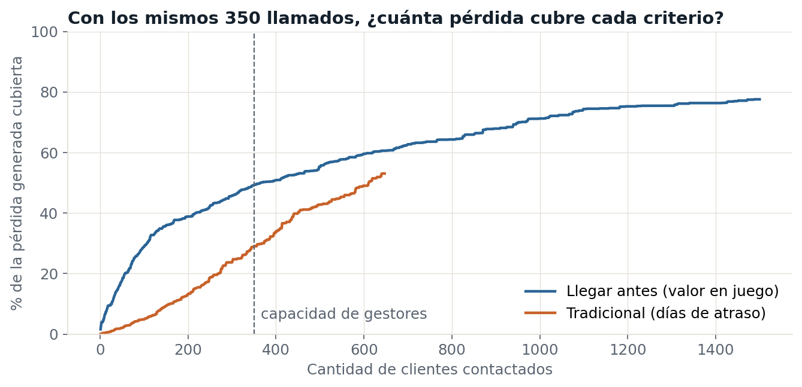
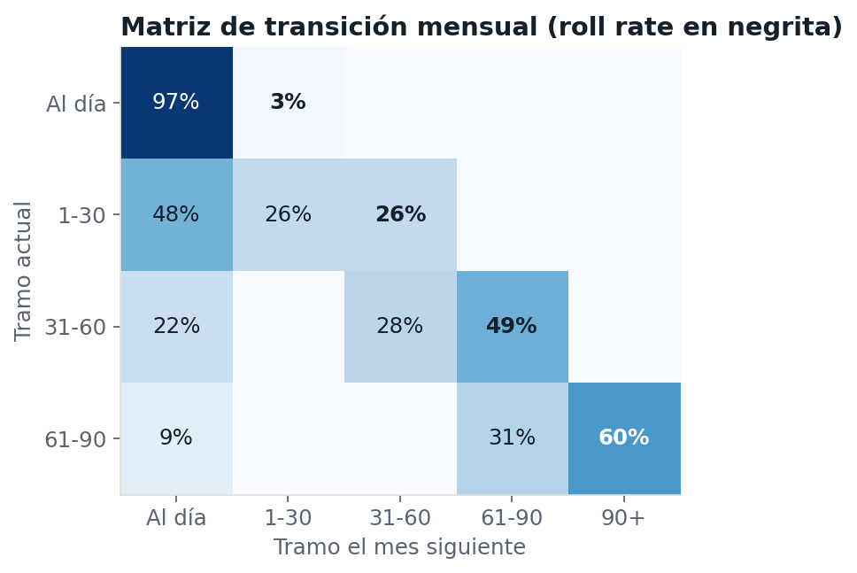
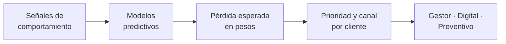
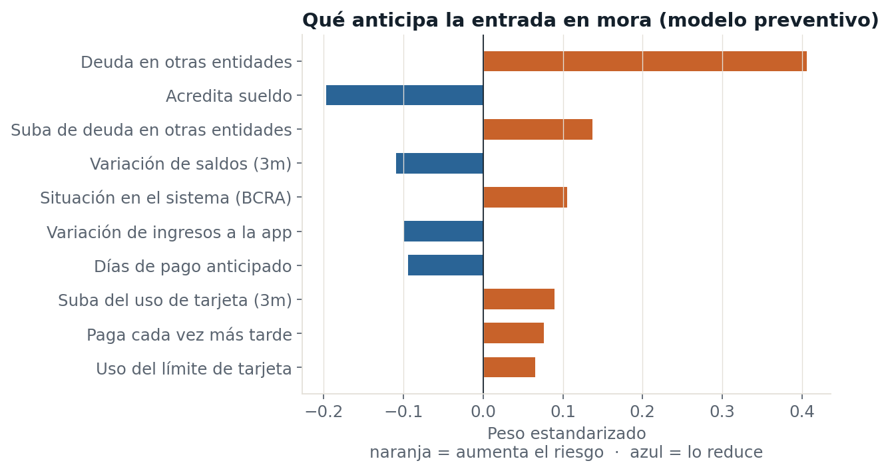
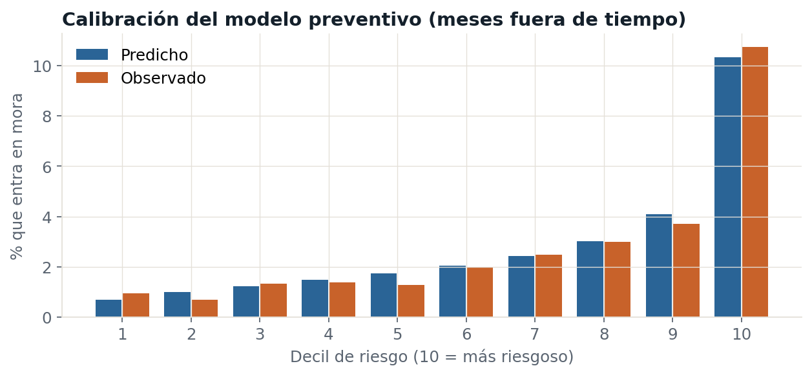

# Llegar antes

### Modelo predictivo de cobranza preventiva y temprana

> Detectar el deterioro del cliente por su comportamiento y resolverlo con él, antes que la mora y antes que el resto del sistema financiero.

**Banco Austral** es una entidad ficticia. Todos los datos son sintéticos, generados por criterio de confidencialidad.

---

## Explorá el proyecto

| Quiero ver… | Abrí |
|---|---|
| **El código completo, celda por celda, con sus resultados** | [modelo_cobranza_temprana.ipynb](modelo_cobranza_temprana.ipynb) |
| Cómo se generan los datos sintéticos | [generar_datos.py](generar_datos.py) |
| Los datos: 60 clientes mes a mes | [muestra_comportamiento.csv](muestra_comportamiento.csv) |
| Los datos fijos de los 12.000 clientes | [clientes.csv](clientes.csv) |
| La lista final priorizada, con canal y motivo | [lista_priorizada.csv](lista_priorizada.csv) |
| Las cifras del backtest | [resultados_clave.json](resultados_clave.json) |

La base completa (216.000 filas) está comprimida en `comportamiento_mensual.csv.gz`; el notebook la lee tal cual.

## Resultados en 30 segundos

Con **la misma capacidad de gestores** (350 llamados por mes), comparamos dos formas de gestionar la mora temprana en un mes que el modelo nunca vio:

| | Gestión tradicional<br/>(por días de atraso) | Llegar antes<br/>(por valor en juego) |
|---|---|---|
| Pérdida generada que pasó por un gestor | 29% | **49%** |
| Pérdida esperada evitada | $ 35,3 M | **$ 54,0 M (+53%)** |
| Pesos de pérdida evitados por peso de gestión | 16,4 | **23,4** |
| Contactos resueltos por canal digital | 46% | **79%** |

Las cifras de pérdida evitada dependen de supuestos de efectividad por canal, explicados abajo.



---

## El problema

La cobranza tradicional actúa cuando el cliente ya está en mora y ordena el trabajo por días de atraso. Eso tiene tres costos:

1. **Llega tarde.** Cuando aparece el primer día de atraso, el cliente muchas veces ya se endeudó en otras entidades.
2. **Gasta gestión donde no hace falta.** Casi la mitad de los clientes en 1-30 días se regulariza al mes siguiente, y muchos lo harían con un simple recordatorio.
3. **No distingue cuánto hay en juego.** Un cliente con alta exposición y alta probabilidad de rolear vale más que uno con más días de atraso pero poca deuda.

Esta es la matriz de transición mensual de la cartera:



La mitad de lo que entra en 31-60 pasa a 61-90, y el 60% de 61-90 cae en 90+. Cada salto de tramo multiplica la pérdida esperada.

## La solución



### 1. Señales de comportamiento

La mora es la consecuencia. Lo que se mide son los cambios previos:

- Deja de acreditar el sueldo.
- Bajan sus saldos.
- Usa cada vez más el límite de la tarjeta.
- Aumenta su deuda en otras entidades o empeora su situación en el sistema.
- Entra menos a la app.
- Paga cada vez más cerca del vencimiento.

### 2. Tres modelos predictivos

| Modelo | Población | Predice | Gini fuera de tiempo |
|---|---|---|---|
| Preventivo | Clientes al día | Entrada en mora el mes próximo | 0,47 |
| Roleo | Mora de 1 a 90 días | Pase al tramo siguiente | 0,59 |
| Self-cure | Mora de 1 a 90 días | Regularización sin intervención | 0,60 |

Cada uno compara una **regresión logística** (explicable) contra **LightGBM** (retador). El retador no mejora de forma relevante, así que en producción queda la logística: se puede defender variable por variable ante un comité, y cada gestor recibe el **motivo** de cada caso.



El modelo está bien calibrado: cuando predice 10%, entra en mora cerca del 10%.



### 3. De probabilidad a pesos

**Pérdida esperada = PD × LGD × EAD**

- La **PD a 12 meses** de cada tramo se obtiene elevando la matriz de transición a la potencia 12 (cadena de Markov): 4% al día, 24% en 1-30, 61% en 31-60 y 87% en 61-90.
- **Valor en juego** de cada cliente = probabilidad de rolear × cuánto sube su pérdida esperada si rolea.

### 4. Prioridad y canal

| Canal | A quién va |
|---|---|
| Gestor humano | Los 350 clientes con mayor valor en juego, estén en mora o todavía al día |
| Digital | Clientes con alta probabilidad de self-cure, el 10% de clientes al día más riesgosos (preventivo) y el resto de la mora |

El resultado es una lista operativa (`lista_priorizada.csv`) con cliente, canal, prioridad y motivo principal en lenguaje de negocio.

---

## La lógica en Python, en cuatro bloques

Extractos del [notebook](modelo_cobranza_temprana.ipynb), donde está el código completo.

**1. Señales de comportamiento** (cambios de los últimos 3 meses, por cliente)

```python
g = p.groupby("cliente_id")
p["corte_sueldo_3m"] = ((p.acredita_sueldo == 0) & (g["acredita_sueldo"].shift(3) == 1)).astype(int)
p["var_saldo_3m"] = (p.saldo_cuentas / ventana("saldo_cuentas", 3) - 1).clip(-1, 3)
p["var_deuda_otras_3m"] = p.deuda_otras_entidades_x_ingreso - g["deuda_otras_entidades_x_ingreso"].shift(3)
p["caida_anticipo"] = ventana("dias_pago_anticipado", 3) - p.dias_pago_anticipado

# Lo que queremos predecir: qué pasa el mes siguiente
p["tramo_sig"] = g["tramo"].shift(-1)
p["entra_mora"] = (p.tramo_sig >= 1).astype(int)          # modelo preventivo
p["rolea"] = (p.tramo_sig > p.tramo).astype(int)           # modelo de roleo
p["se_cura"] = (p.tramo_sig == 0).astype(int)              # modelo de self-cure
```

**2. Entrenar con el pasado, validar con el futuro**

```python
ENTRENAMIENTO = range(6, 14)      # 8 meses
FUERA_DE_TIEMPO = range(14, 17)   # 3 meses que el modelo nunca ve

log = make_pipeline(StandardScaler(), LogisticRegression(max_iter=2000)).fit(X, y)
gbm = LGBMClassifier(n_estimators=300, learning_rate=0.04, num_leaves=15).fit(X, y)   # retador

auc = roc_auc_score(y_oot, log.predict_proba(X_oot)[:, 1])
gini = 2 * auc - 1
```

**3. De probabilidad a pesos: PD por tramo con cadena de Markov**

```python
M = pd.crosstab(trans.tramo, trans.tramo_sig, normalize="index")   # matriz de roll rates
M12 = np.linalg.matrix_power(M.values, 12)                          # 12 meses hacia adelante
PD = M12[:, 4]                                                      # prob. de terminar en 90+

d["salto_pd"] = d.tramo.map(lambda k: PD[k + 1] - PD[k])
d["perdida_si_ocurre"] = d.exposicion * LGD * d.salto_pd
d["valor_en_juego"] = d.p_evento * d.perdida_si_ocurre
```

**4. Prioridad y canal**

```python
autocura = mora & (d.p_cura >= 0.60) & (d.tramo == 1)               # se cura solo → digital
candidatos = d[~autocura].sort_values("valor_en_juego", ascending=False)
d.loc[candidatos.index[:350], "canal"] = "Gestor"                   # capacidad del equipo
d.loc[mora & (d.canal == "Sin contacto"), "canal"] = "Digital"
```

## Tablero de seguimiento

**[Abrir el tablero interactivo](https://claude.ai/artifact/DPiUunzL3ohb3VKCeBCowg)**

Un tablero pensado para la reunión de estrategia: filtros globales de **año, mes y tramo**, y cuatro preguntas en orden de lectura.

1. **¿Estamos cumpliendo la estrategia?** Siete indicadores del mes contra su meta (en meta, cerca o fuera) y contra el mismo mes del año anterior, con una conclusión escrita que señala el mayor desvío.
2. **¿Cómo venimos contra el año anterior?** Tendencia mensual del indicador elegido, año actual contra año previo y meta, más un semáforo tramo por indicador.
3. **¿Dónde pierde efectividad la operación?** Embudo de gestión (gestionados, contactados, con promesa, promesa cumplida) con la etapa de mayor pérdida, y la relación entre intensidad y contactabilidad para ver si más intentos todavía rinden.
4. **¿Dónde actuamos el próximo mes?** Asignación por canal y tramo, evidencia del backtest y lista de contactos priorizada (salida del modelo).

Cierra con un **analista de IA** que lee la vista filtrada: genera insights, arma un reporte para el comité y responde preguntas sobre los datos. Funciona al abrir el tablero con una cuenta de Claude.

| Indicador | Definición |
|---|---|
| Tasa de recupero | Monto recuperado en el mes / saldo del tramo al inicio del mes |
| Roll rate | Saldo que pasa al tramo siguiente / saldo inicial |
| Self-cure | Clientes que vuelven a estar al día sin gestión / clientes del tramo |
| Contactabilidad | Clientes contactados / clientes gestionados |
| Efectividad | Promesas cumplidas / clientes contactados |
| Intensidad | Intentos de contacto por cliente gestionado |
| Expected Loss | Pérdida esperada: PD a 12 meses × LGD 55% × saldo |

Datos del tablero: [cartera_gestion_mensual.csv](cartera_gestion_mensual.csv), serie sintética por tramo de oct 2023 a sep 2026, calibrada con los niveles del modelo y generada con [generar_cartera_gestion.py](generar_cartera_gestion.py). Lista para conectar a Looker Studio o Power BI.

## Decisiones de diseño

| Decisión | Por qué |
|---|---|
| Regresión logística en lugar de LightGBM | Rinden igual, y la logística es explicable y defendible ante un comité |
| Validación fuera de tiempo (8 meses de entrenamiento, 3 de prueba) | Así se usa en la realidad: entrenar con el pasado, aplicar al futuro |
| Excluir "días de atraso" del modelo de roleo | Está casi explicado por el tramo; juntos generaban pesos con signo engañoso |
| Priorizar por valor en pesos, no por probabilidad | Un 60% de probabilidad sobre $ 20 M importa más que un 90% sobre $ 500 mil |
| Contactar clientes al día | La forma más barata de evitar mora es que no ocurra |

## Supuestos y limitaciones

- **Datos sintéticos.** Las relaciones entre variables las define el simulador (`generar_datos.py`). Con datos reales las métricas cambian y hay que recalibrar.
- **Efectividad por canal (supuesto):** un gestor reduce 30% la probabilidad de rolear o entrar en mora; el canal digital, 10%. En producción se mide con un **grupo de control** antes de escalar.
- **Costos por contacto (supuesto):** gestor $ 6.000, digital $ 150.
- **LGD fija del 55%** para consumo sin garantía. Un modelo de LGD por producto y tramo mejoraría la estimación.
- El histórico no registra qué gestión recibió cada cliente. Con datos reales habría que aislar ese efecto.

## Próximos pasos

- [ ] Flujo en **n8n** que lea la lista priorizada, dispare mensajes por canal digital y alerte desvíos.
- [ ] Tablero de roll rates en **Looker Studio**, alimentado por `roll_rates_mensual.csv`.
- [ ] **Plan Anticipa:** refinanciación preventiva, sin bajar la tasa de entrada, para clientes al día de alto valor en juego, con premio al cumplir el plan.
- [ ] Agentes de IA que asignen estrategia a cada call center y reporten el cluster crítico.

---

## Cómo correrlo

```bash
pip install -r requirements.txt
python generar_datos.py                 # genera los datos sintéticos
jupyter notebook modelo_cobranza_temprana.ipynb
```

También se puede abrir en **Google Colab**: subí los archivos del repositorio a una carpeta y ejecutá las celdas en orden.

## Archivos

| Archivo | Qué es |
|---|---|
| `modelo_cobranza_temprana.ipynb` | El análisis completo: roll rates, modelos, validación, estrategia y backtest |
| `generar_datos.py` | Simulador de la cartera sintética |
| `clientes.csv`, `comportamiento_mensual.csv.gz` | Datos sintéticos (12.000 clientes, 18 meses) |
| `muestra_comportamiento.csv` | Muestra legible: 60 clientes mes a mes |
| `lista_priorizada.csv` | Lista operativa del próximo mes: canal, prioridad y motivo |
| `roll_rates_mensual.csv` | Insumo para tableros |
| `kpis_mensuales.csv` | Indicadores mensuales del tablero de seguimiento |
| `cartera_gestion_mensual.csv`, `generar_cartera_gestion.py` | Serie mensual por tramo para el tablero: cartera y gestión de cobranza |
| `resultados_clave.json` | Cifras del backtest |
| `01_…png` a `06_…png` | Gráficos del análisis |
| `construir_notebook.py` | Arma el notebook a partir de sus celdas |

## Stack

Python · pandas · scikit-learn · LightGBM · matplotlib

---

**Sofía León** · Riesgo de crédito, cobranzas y automatización
